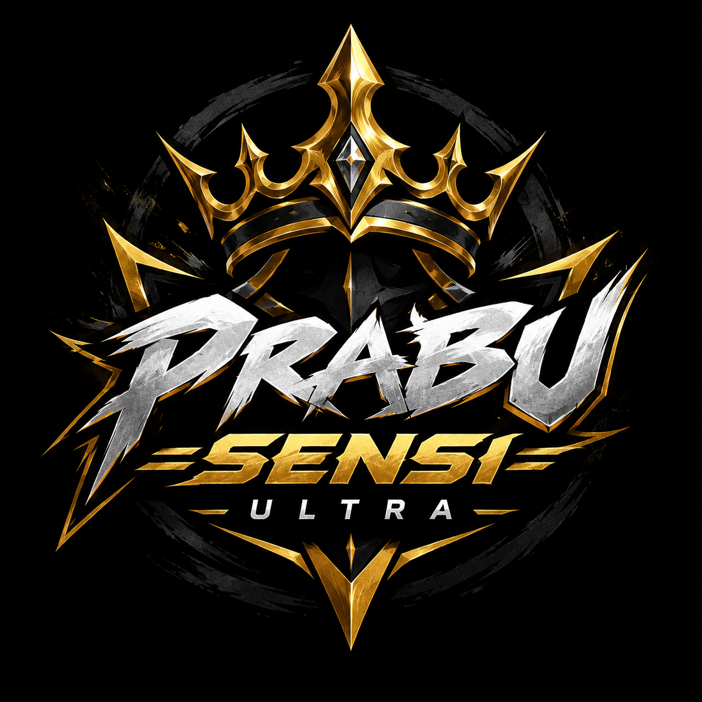

# Prabu Sensi Ultra — Website Store Panel

Website storefront statis untuk jual panel Prabu Sensi Ultra. Tema dark royal gold, katalog fitur, daftar harga perorangan & reseller, dan checkout langsung ke WhatsApp.

Tanpa build step, tanpa framework, tanpa dependency. Cukup upload folder ini ke hosting.

## Fitur

- Hero dengan emblem logo, status server, dan statistik.
- Katalog 7 fitur dengan filter kategori (`Aim`, `ESP Visuals`, `Safety`) dan pencarian.
- 8 paket perorangan + 4 paket reseller, harga per hari dan badge hemat otomatis.
- Modal checkout: pilih paket → isi data → kirim order ke WhatsApp (teks order otomatis).
- Deep link checkout: `?paket=week` atau `?paket=rs25&tipe=reseller`.
- Support penuh Free Fire MSI 5.22 terbaru, alur order, testimoni, FAQ accordion.
- Responsive (desktop, tablet, mobile), meta SEO + OG image, favicon.
- Animasi reveal, ticker, dan hover halus dengan dukungan `prefers-reduced-motion`.

## Struktur

```
index.html
assets/
  css/style.css
  js/app.js
  img/
    logo.png          logo asli PRABU SENSI ULTRA (1254x1254, tanpa edit)
    freefire.png      ikon game Free Fire
    og-cover.jpg      social preview 1200x630
```

## Jalankan lokal

Dari folder ini:

```bash
python -m http.server 8080
```

Buka `http://localhost:8080`. Bisa juga pakai ekstensi Live Server di VS Code.

## Konfigurasi wajib sebelum live

Semua pengaturan toko ada di bagian atas `assets/js/app.js`:

```js
const STORE = {
  name: "Prabu Sensi Ultra",
  whatsapp: "6281234567890",   // format 62xxx, tanpa + dan spasi
  discord: "https://discord.gg/prabusensi",
  telegram: "https://t.me/prabusensi",
  currency: "Rp",
};
```

| Field | Keterangan |
| --- | --- |
| `whatsapp` | Nomor admin. Dipakai untuk semua tombol WhatsApp dan pengiriman order. |
| `discord` | Link invite server Discord. |
| `telegram` | Link kontak/grup Telegram. |
| `name` | Nama toko yang muncul di teks order. |

Link di header, footer, dan modal otomatis mengikuti konfigurasi ini.

## Ubah harga

Edit object `PLANS` di `assets/js/app.js`. Ada dua tier: `personal` dan `reseller`.

```js
{
  id: "week",              // dipakai untuk deep link ?paket=week
  name: "1 Minggu",
  days: 7,
  price: 60000,
  old: 75000,              // harga coret, opsional
  badge: "Paling Laris",   // opsional
  popular: true,           // border emas + tombol gold
  note: "Pilihan 8 dari 10 user.",
  features: ["Semua fitur kebuka", "Prioritas update", "Grup tips & config"],
}
```

- `days: 0` = Lifetime (harga per hari tidak dihitung).
- Diskon dihitung otomatis dari `Rp10.000/hari` untuk tier personal.
- Untuk reseller, tambahkan `accounts: 25` (jumlah key). Persentase hemat dihitung dari `old`.

Harga saat ini:

| Paket | Harga |
| --- | --- |
| 1 Hari | Rp10.000 |
| 3 Hari | Rp28.000 |
| 1 Minggu | Rp60.000 |
| 2 Minggu | Rp105.000 |
| 1 Bulan | Rp180.000 |
| 2 Bulan | Rp320.000 |
| 3 Bulan | Rp450.000 |
| Lifetime | Rp700.000 |

Reseller: Starter 5 key Rp200.000, Pro 10 key Rp350.000, Sultan 25 key Rp750.000, Partner 50 key Rp1.250.000.

## Ubah katalog

Edit array `FEATURES` di `assets/js/app.js`. Setiap item:

```js
{
  name: "ESP Healthbar",
  desc: "Deskripsi singkat.",
  cat: "ESP",          // label di kartu
  catKey: "esp",       // filter: aim | esp | safety
  tier: "PRO",         // ULTRA | PRO | NEW
  icon: "pulse",       // key dari object ICONS
  games: "Free Fire",  // teks kanan bawah kartu
}
```

Katalog sekarang: AimNeck, ESP Line, ESP Command Box, ESP Healthbar, Anti-Ban Shield, HWID Spoofer, Stream Mode.

Kalau menambah kategori baru, tambahkan tombol filter di `index.html`:

```html
<button class="chip" data-filter="misc" role="tab" aria-selected="false">Misc</button>
```

lalu pakai `catKey` yang sama di item katalog.

## Logo & aset brand

- `assets/img/logo.png` — logo asli PRABU SENSI ULTRA yang dikirim Olivia, 1254x1254. Dipakai apa adanya di header, hero, CTA, footer, favicon, dan apple touch icon. Jangan diedit, jangan di-crop, jangan diganti SVG.
- `assets/img/freefire.png` — ikon game Free Fire untuk kartu support.
- `assets/img/og-cover.jpg` — preview sosial 1200x630, dibuat pakai file logo asli.

Mau ganti logo? Timpa `assets/img/logo.png` dengan file asli baru. Jangan ubah rasio atau menambahkan efek permanen ke file-nya.

```html

```

## Alur checkout

1. User pilih paket di section Harga → modal terbuka.
2. Isi nama, WhatsApp, metode bayar, catatan. Field game terkunci ke **Free Fire · MSI 5.22**.
3. Klik **Kirim via WhatsApp** → WhatsApp terbuka dengan teks order lengkap (kode order, paket, durasi, harga, data user).
4. Admin verifikasi pembayaran dan kirim key secara manual.

Tidak ada backend, database, atau payment gateway. Kalau nanti mau verifikasi otomatis, sambungkan tombol/modal ke Midtrans, Xendit, Tripay, atau webhook Discord.

## Deploy

Semua opsi di bawah tanpa build command, publish langsung dari root folder:

- **Netlify Drop** — drag folder ke app.netlify.com/drop.
- **Vercel** — import folder sebagai static project.
- **GitHub Pages** — push ke repo, aktifkan Pages dari branch utama.
- **cPanel / hosting biasa** — upload isi folder ke `public_html`.

Setelah domain aktif, ganti `og:image` di `index.html` menjadi URL absolut:

```html
<meta property="og:image" content="https://domain-lo.com/assets/img/og-cover.jpg" />
```

## Checklist sebelum live

- [ ] Ganti `STORE.whatsapp` ke nomor admin asli.
- [ ] Ganti link Discord dan Telegram.
- [ ] Cek ulang semua harga dan isi paket.
- [ ] Pastikan katalog sesuai menu panel yang aktif.
- [ ] Pastikan `assets/img/logo.png` tetap file logo asli, tanpa edit.
- [ ] Tes tombol **Pilih paket** dan **Kirim via WhatsApp** di HP.
- [ ] Set URL absolut untuk `og:image`.
- [ ] Aktifkan HTTPS di hosting.
